## 一个go语言实现的博客 
## A blog written in the go programming language 

## 多用户支持，权限管理
## Multi user support, permission management


### 技术栈
### Technology stack 
- golang [https://golang.google.cn](https://golang.google.cn)
- vue3+vite4+pinia+typescript
- xorm [https://xorm.io](https://xorm.io)
- echo v4 [https://echo.labstack.com](https://echo.labstack.com)
- naiveui [http://naiveui.com](http://naiveui.com)
- UI 修改于 [https://firekylin.org](https://firekylin.org)

## 预览地址
## Preview address 
[https://blog.zxysilent.com](https://blog.zxysilent.com)

## 仓库地址
## Repository  address 
[github(https://github.com/zxysilent/blog)](https://github.com/zxysilent/blog)

[gitee(https://gitee.com/zxysilent/blog)](https://gitee.com/zxysilent/blog)

## 本地开发
## Local development

开两个终端，各自常驻，改代码即时生效，不需要手动重启。

后端（`fish run` 热重载：改 .go / .html 自动重编译并重启）：

```bash
fish run          # 或 ./dev-srv.sh（额外带 -all，也监听 views 下的模板）
```

管理端 `mgmt`（Vite 热更新，`/api`、`/static` 代理到 8085）：

```bash
cd mgmt && pnpm run dev    # 或 ./dev-mgmt.sh（首次会自动装依赖）
```

- 前端地址 `http://localhost:8001`，后端地址 `http://localhost:8085`
- `mgmt` 的依赖由 pnpm 管理（有 `pnpm-lock.yaml`），装包和跑脚本都用 `pnpm`；
  `mgmt/.npmrc` 里的 `node-linker` / `verify-deps-before-run` 是 pnpm 专用键，
  在 `mgmt` 目录下用 `npm run` 会打印 `Unknown project config` 警告
- 改 `mgmt/src/**` 走 HMR，页面不刷新；改后端 `.go` 由 fish 重编译重启，前端无需重启
- 默认管理员账号 `root / admin888`
- 本地没有 MySQL 时，把 `conf.toml` 的 `[db] type` 改成 `sqlite` 即可，
  `sqlite = "file:sqlite.db?_pragma=busy_timeout(5000)"`；
  令牌密钥、上传限制、SQL 日志等运行时参数在后台「配置管理」里在线调整，改完立即生效。

首次启动若提示某张表结构变更并 drop 重建，属于预期行为：
`permission` / `role_permission` 由路由派生，`dict` / `dict_entry` 由代码默认值重新种入，
不做任何迁移脚本。

## 开发原因 
- 现在自己使用博客系统不方便管理、部署和二次开发
- 渲染速度到不到想要的效果

## 计划功能
实现```blog```功能,方便二次开发
- [x] 博文管理
- [x] 分类管理
- [x] 标签管理
- [x] 系统设置
- [x] 管理主页
- [x] 笔记模式
- [x] 用户管理
- [x] 角色管理
- [x] 全局配置
- [x] 个性化配置
- [x] 笔记分享
- [x] 配置字典
## 说明

- 替换markdown 编辑器为富文本编辑器`web/src/components/Editor/Richtext`即可作为简单`CMS`
- 注意配置使用的数据库
    ```
    # mysql\sqlite
    type = "sqlite"
    # uid:pass@tcp(host:port)/dbname?charset=utf8mb4&parseTime=true&loc=Local
    mysql = "root:root@tcp(127.0.0.1:3306)/blog?charset=utf8mb4&parseTime=true&loc=Local"
    sqlite = "file:blog.db"
    ```
## 讨论群
🐧🐧 1059282178

## 使用方式-直接部署
```
git clone -b next --depth=1 https://github.com/zxysilent/blog.git
```
若要部署，请修改关键信息[token、用户名、密码等]
数据库自带文章内容请在部署前删除

### 部署界面
- 安装依赖```npm install```
- 修改```.env.development```中的```VITE_APP_SRV```为自己的服务地址
- 发布```npm run build```会自动发布到```dist```目录下面
- 友链里面第一个为后台登陆地址默认用户名```zxysilent```,密码```zxyslt```，可自行数据库修改
### 部署服务
- 配置```conf.toml```数据库信息
- 还原```data```目录下```blog.sql```数据库
*数据库自带文章内容请在部署前删除*
- 安装依赖```go mod tidy```
- 编译可执行程序 
    - 普通开发编译版本```go build```
    - 编译不带日志和swagger文档版本```go build -tags=prod```体积大幅度减小,日志请用```nginx、caddy```等```web```服务器记录
    - 若需要日志且不需要文档，请自定义开发或提issues
- 服务器部署
    - windows 直接运行
    - linux 普通方式```nohup ./blog>>nohup.log 2>&1 &```

### 评论配置
- 配置项目 sys_global(表).comment(值) 
- 配置说明 [https://github.com/gitalk/gitalk](https://github.com/gitalk/gitalk)

## 使用方式-自定义开发
```
git clone https://github.com/zxysilent/blog.git
```
若要部署，请修改关键信息[token、用户名、密码等]
*数据库自带文章内容请在部署前删除*

### 开发界面
- 安装依赖```npm install```
- 开发运行```npm run serve```
- 浏览器打开 [http://127.0.0.1:8082/](http://127.0.0.1:8082/)
- 友链里面第一个为后台登陆地址默认用户名```zxysilent```,密码```zxyslt```，可自行数据库修改
###  开发服务
- 配置```conf.toml```数据库信息
- 还原```data```目录下```blog.sql```数据库
*数据库自带文章内容请在部署前删除*
- 安装依赖```go mod tidy```
- 安装 swag   
    - ```go get -u github.com/swaggo/swag/cmd/swag```
- 运行```swag init```生成api文档
- 运行后台```go run```
- 浏览器默认访问 [http://127.0.0.1:8085/](http://127.0.0.1:8085/)

## 渲染性能
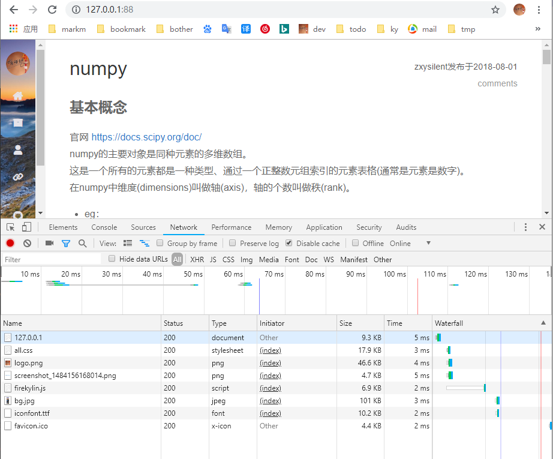

## 效果展示

### 前台
- 首页
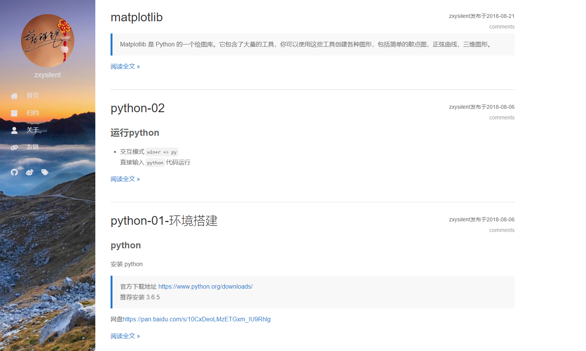
- 归档

- 关于
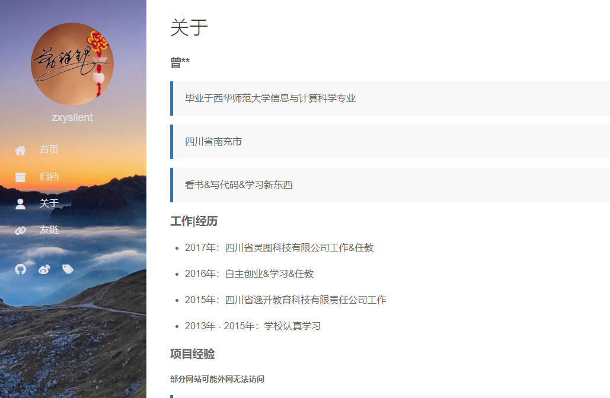

### 后台
- 登录
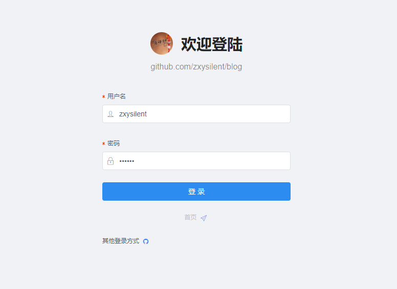
- 首页
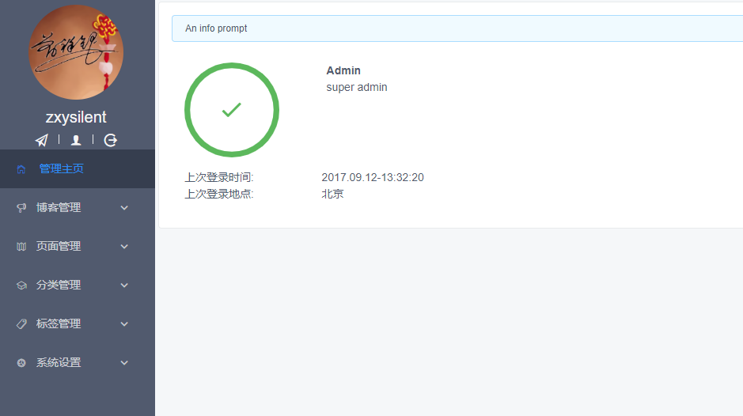
- 文章
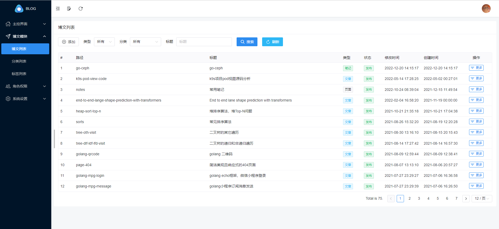
- 文章编辑
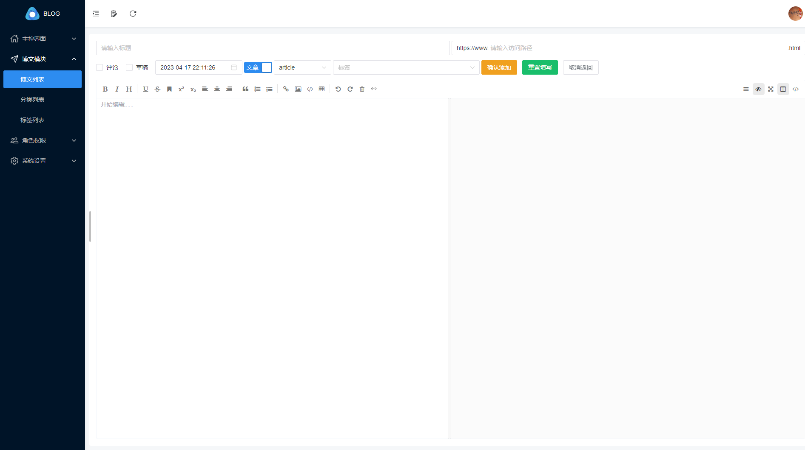
- 配置
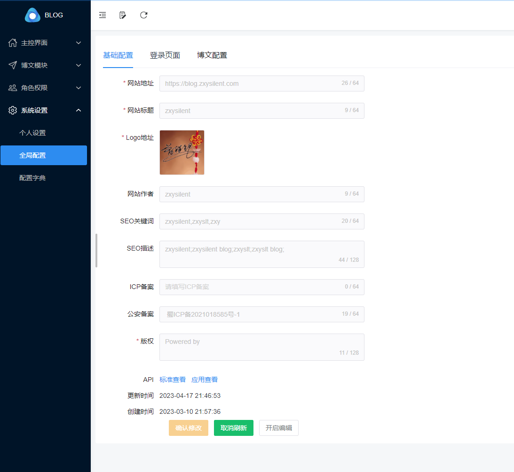
- 权限
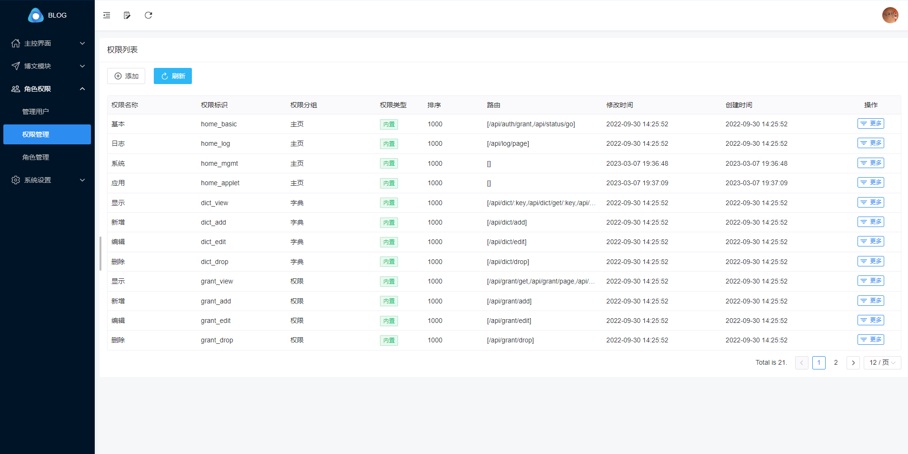
- 授权
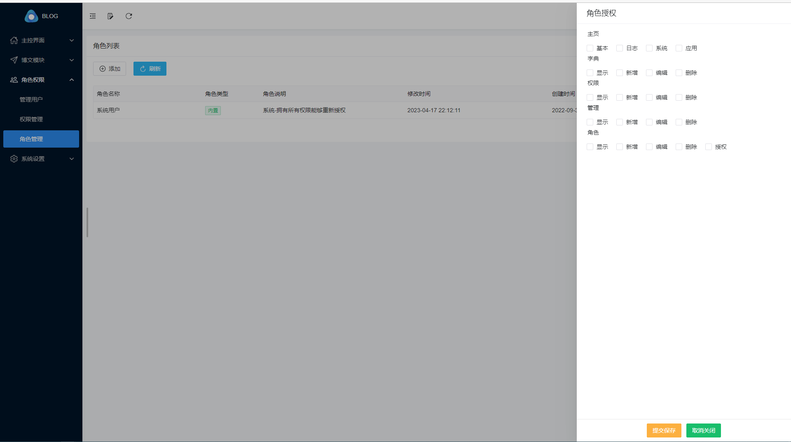
- 笔记模式
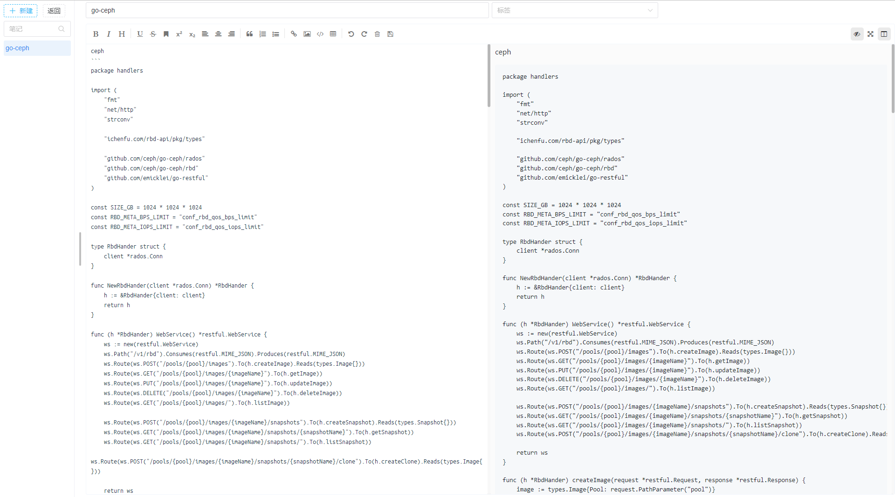
- 笔记分享
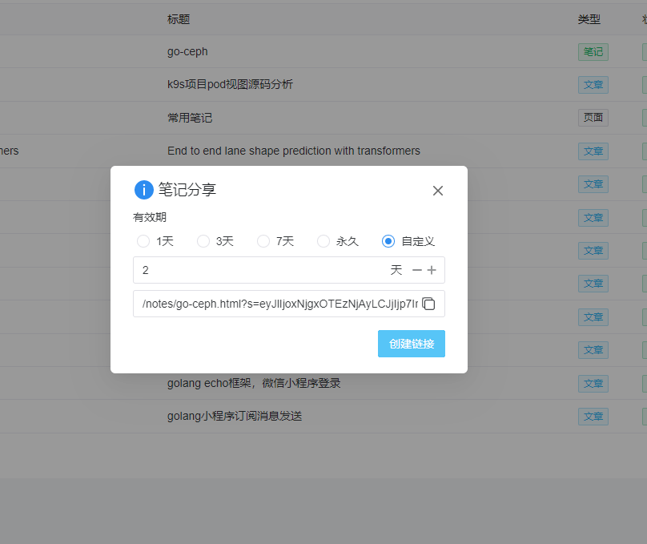
## Donation
If this project help you a lot, you can support us by:

AliPay


Wechat Pay

